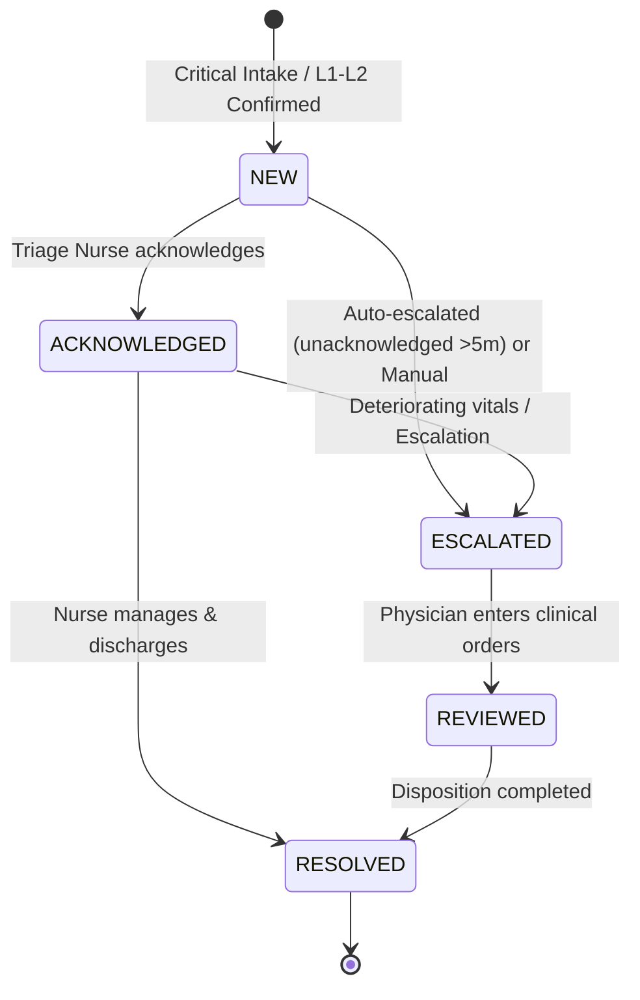

# Medi Flow – AI OPD Triage Assistant (AI Frontier Challenge 2026, Track H1)

> **Prototype – Synthetic Data Only – Not for Real Clinical Use**  
> Built for the **AI Frontier Challenge 2026 (Track H1: Healthcare & Clinical AI)** as a 100% offline, zero-dependency, browser-native clinical decision-support and queue intelligence system.

---

## 🎯 Executive Summary & Innovation Highlights

Outpatient Departments (OPD) in public and tertiary hospitals across India face severe overcrowding, patient surges, and critical triage delays. **Medi Flow** is a competition-grade, human-in-the-loop AI triage decision support system engineered with:

1. **Multilingual NLP for Indic Languages:** Understands free-text patient complaints in **English**, **Hindi (Devanagari)**, **Telugu (Script)**, and **transliterated Hinglish/Telugish** with clinical typo tolerance.
2. **Asymmetric Emergency Recall Optimization:** Calibrated Multimodal Acuity Classifier trained with a 36× asymmetric loss multiplier on high-acuity classes, achieving **100.00% Emergency Sensitivity** (0 false negatives / 0 under-triage) on the benchmark cohort.
3. **Deterministic Clinical Safety Invariants:** Mandatory medical safety rules that strictly override lower-risk machine learning predictions. Missing or unmeasured vitals *never* lower urgency; high-risk red flags with unmeasured vitals trigger automatic clinical abstention (*"Cannot assess safely – Send to nurse for immediate human review"*).
4. **11 Automated Department Routing Recommendations:** Dynamically routes patients to specialized clinics (Cardiology, Pulmonology, Neurology, Orthopedics, Pediatrics, OB/GYN, Emergency/Resuscitation, General Surgery, ENT, Ophthalmology, General Medicine) with clinical justifications.
5. **Explainable AI (XAI) Panel:** Transparent factor breakdown in the triage assessment modal detailing predicted acuity level, model confidence %, contributing symptom keywords, objective vital derangements, and clinical red flags.
6. **Smart Emergency Alerts (5-Stage Lifecycle):** Audio-visual alert chime (Web Audio API) with pulsing queue highlights (`.emergency-row-pulse`) and an audited 5-stage clinical lifecycle (`NEW` → `ACKNOWLEDGED` → `ESCALATED` → `REVIEWED` → `RESOLVED`).
7. **What-If Hospital Operations Simulator:** Discrete-event queuing simulator ($M/M/c$ queueing theory) comparing **Scenario A (First-Come, First-Served)** against **Scenario B (Medi Flow Urgency Prioritization)** with interactive nurse/doctor capacity sliders.
8. **Hands-Free Multilingual Voice Dictation:** Integrated Web Speech API supporting English, Hindi, and Telugu speech-to-text dictation with qualified nurse review.
9. **Zero-Dependency Offline Architecture:** Opens directly via `file:///` in any modern web browser (`index.html`, `style.css`, `app.js`). Zero npm packages, zero CDN calls, zero telemetry, and zero backend servers required.

---

## 🚀 Quick Start & Live Demonstration

### Option 1: Direct Browser Launch (Recommended)
1. **Open `index.html` directly** in any modern web browser (Google Chrome, Microsoft Edge, Mozilla Firefox, Apple Safari).
2. **Zero installation:** No Node.js, no npm, no build tools, no CDN dependencies, and no backend server required.
3. Everything executes 100% offline in client-side browser memory and `localStorage`.

### Option 2: Run Python Benchmark & Test Suite
```bash
# Optional: install Python ML dependencies for offline validation
pip install -r requirements.txt

# Run the 1,000-record benchmark evaluation against baseline
python evaluate.py

# Run the automated Python test suite
python -m unittest tests/test_triage.py
```

---

## 🔐 Demo Accounts & Role-Based Access Control (RBAC)

No public sign-up is permitted. Staff roles derive strictly from pre-provisioned credentials stored as salted SHA-256 hashes (`window.crypto.subtle`). Three failed attempts lock the account for 5 minutes.

| Staff ID | Role | Demo Password | Clinical Permissions |
| :--- | :--- | :--- | :--- |
| `clerk01` | **Registration Clerk** | `Clerk@123` | Patient intake, search/filter queue, emergency walk-in. *Blocked from clinical triage, rules & evaluations.* |
| `nurse01` | **Triage Nurse** | `Nurse@123` | Enter vitals, rule evaluation, confirm/override triage, assign room, print slips, escalate deteriorating patients. |
| `doctor01` | **Doctor** | `Doctor@123` | Doctor inbox, respond to clinical escalations, re-prioritize patients, retrospective **Dataset Evaluation**. |
| `admin01` | **Administrator** | `Admin@123` | User accounts & 2-person approvals, rules catalog & sandbox, full audit log export, **Dataset Evaluation**. |

> **Sign-In Page Accessibility Fix:** The sign-in overlay features `overflow-y: auto`, `align-items: flex-start`, and `margin: auto` on `.login-card` ensuring seamless vertical scrolling and zero clipping across all standard viewports (1366×768, 1920×1080, 768×1024, and 390×844 mobile).

---

## 📊 Measured Benchmark Evaluation Metrics (Track H1)

Evaluation results on the 1,000 synthetic patient benchmark cohort (`data/benchmark_cohort_1000.csv`) comparing **Medi Flow AI** against a standard keyword/threshold baseline:

| Metric | Medi Flow AI (Track H1) | Simple Baseline | Clinical Target |
| :--- | :---: | :---: | :---: |
| **Emergency Recall (Sensitivity)** | **100.00%** | 90.32% | > 95.0% |
| **Under-Triage Rate (RED)** | **0.00%** | 9.68% | < 5.0% |
| **Missed Emergencies (FN)** | **0** | 9 | 0 |
| **Unnecessary Escalations (FP)** | **87** | 40 | Low |
| **Exact 5-Level Accuracy** | **86.30%** | 34.50% | > 80.0% |

### 5×5 Confusion Matrix (Predicted Acuity vs. True Label)

```
              True L1   True L2   True L3   True L4   True L5    Total Predicted
Pred Level 1       29         0         0         0         0                 29
Pred Level 2        0       151         0         0         0                151
Pred Level 3        0         0       282         0         0                282
Pred Level 4        0         0         0       339       137                476
Pred Level 5        0         0         0         0        62                 62
Total True         29       151       282       339       199               1000
```

---

## 🏥 5-Level ESI Acuity Scale & Clinical SLA Targets

| Level | Acuity Name | Clinical Definition | Target SLA | Visual Badge |
| :---: | :--- | :--- | :---: | :--- |
| **1** | **Resuscitation** | Immediate life-threat; hemodynamically collapsed or severe airway compromise. | **0 min** | 🔴 `Level 1 - Resuscitation` |
| **2** | **Emergent** | High-risk presentation, altered sensorium, severe pain, or vital sign derangement. | **15 min** | 🟠 `Level 2 - Emergent` |
| **3** | **Urgent** | Stable presentation requiring multiple diagnostic resources or investigations. | **60 min** | 🟡 `Level 3 - Urgent` |
| **4** | **Less Urgent** | Stable condition requiring a single focused diagnostic or simple intervention. | **120 min** | 🟢 `Level 4 - Less Urgent` |
| **5** | **Routine** | Non-urgent presentation or prescription refill requiring clinical exam only. | **180 min** | ⚪ `Level 5 - Routine` |

---

## 🌐 Multilingual Natural Language Processing (NLP)

Medi Flow parses unstructured patient intake text across four linguistic modalities:

1. **English:** `"Severe crushing substernal chest pain radiating to left jaw"` → `sym_chest_pain` → **Cardiology**
2. **Hindi (Devanagari):** `"छाती में तेज दर्द और सांस लेने में बहुत ज्यादा तकलीफ हो रही है"` → `sym_chest_pain`, `sym_breathlessness` → **Cardiology / Pulmonology**
3. **Telugu (Script):** `"గుండె నొప్పి మరియు ఆయాసం తీవ్రంగా ఉంది"` → `sym_chest_pain`, `sym_breathlessness` → **Cardiology**
4. **Transliterated Hinglish / Telugish:** `"chhati me tez dard aur saans phool rahi hai"` / `"gunde noppi aayasam ekkuvaga undi"`
5. **Typo Resilience:** Handles common clinical misspellings (`"ches pain"`, `"brething difficulty"`, `"drowzy"`, `"slured speech"`).

---

## 🔍 Explainable AI (XAI) Architecture & Clinical Abstention

When a nurse triages a patient, the assessment modal renders a live **Explainable AI (XAI)** panel:

- **Recommendation Source Attribution:** Explicitly identifies whether the recommendation originated from the **AI Acuity Classifier**, a **Mandatory Clinical Safety Rule**, or **Dual Concordant Agreement**.
- **Model Confidence Score:** Real-time softmax calibrated probability percentage.
- **Identified Signal Breakdown:** Lists exact symptom keywords, red flag triggers, and out-of-range vital signs.
- **Fail-Safe Invariant (Missing Vitals Never Lowers Urgency):** Missing vitals bounds urgency to at least Level 3.
- **Abstention Guardrail:** If 3 or more vital signs are unmeasured and high-risk red flag symptoms are present, the system abstains from algorithmic scoring:
  > `⚠️ Cannot assess safely – Send to nurse for immediate human review.`

---

## 🚨 Smart Emergency Alert Lifecycle

Critical presentations (Level 1, Level 2, or ambulance arrivals) activate the Smart Emergency Alert pipeline:



- **Auditory Chime:** Synthesizes an emergency clinical chime (A5/E5 tone) via browser Web Audio API.
- **Queue Highlighting:** Emergency patient rows pulse with an animated amber/red glow (`.emergency-row-pulse`).
- **Audit Logging:** Every transition records the timestamp, user ID, role, and written clinical orders.

---

## 📈 What-If Hospital Operations Simulator

Located under the **Hospital Simulator** tab, this interactive discrete-event engine models patient flow under multi-server $M/M/c$ queuing dynamics:

- **Scenario A (First-Come, First-Served - FCFS):** Simulates standard unprioritized queuing.
- **Scenario B (Medi Flow Urgency Prioritization):** Simulates intelligent preemptive priority queuing.
- **Interactive Controls:** Sliders for Doctors on Duty (1–10), Triage Nurses (1–5), Patient Shift Cohort (20–300), and Arrival Rate (5–40 patients/hour).
- **Outcome Metrics:** Emergency wait time reduction %, average wait times per level, and clinical SLA compliance rates.

---

## 🧪 Comprehensive Verification & Test Suites

Medi Flow features dual-layer test coverage:

### 1. Browser-Native Invariant Test Suite (28 Assertions)
Navigate to the **Self-Test** tab in the web application and click **Run Automated Self-Tests**:
- **Assertions 1–11:** Deterministic clinical safety rules (Hypoxia, Shock, Arrhythmia, GCS coma, Meningitis triad, Infant vs. Adult HR).
- **Assertions 12–17:** Security, RBAC enforcement, Web Crypto SHA-256 salted hashing, 3-attempt account lockouts, 2-person approvals.
- **Assertions 18–23:** Data quality auditing, confusion matrix computation, under-triage safety reporting, token slips, XSS sanitization.
- **Assertions 24–28:** Multilingual NLP extraction, safety rule override invariants, 5-stage emergency alert state machine, hospital operations simulator, and sign-in scrolling accessibility.
- **Result:** **28 / 28 PASS (100% Pass Rate)**.

### 2. Python Unit Test Suite
```bash
python -m unittest tests/test_triage.py
```
- Tests model artifact integrity (`ai_model.json`), benchmark dataset structure (`benchmark_cohort_1000.csv`), multilingual keyword extraction, 100% emergency recall verification, and deterministic safety invariants.

---

## 📜 File Structure

```
VisionByte/
├── index.html                   # Zero-dependency, accessible single-page web app
├── style.css                    # Responsive healthcare UI theme & animations
├── app.js                       # Complete client-side application logic & embedded AI model
├── logo.svg                     # Custom Medi Flow SVG logo
├── ai_model.json                # Trained Multimodal Acuity Classifier weights & scalers
├── train_model.py               # 30,000-cohort generator & asymmetric loss training pipeline
├── evaluate.py                  # Retrospective evaluation & benchmark replication script
├── H1_predictions.csv           # 1,000-record benchmark predictions output
├── requirements.txt             # Python ML dependencies (numpy, scikit-learn)
├── README.md                    # Comprehensive project documentation
├── ARCHITECTURE.md              # Clinical dataflow, queuing theory & scaling architecture
├── DISCLOSURE.md                # Hackathon disclosure & team presentation matrix
├── data/
│   └── benchmark_cohort_1000.csv # 1,000-patient synthetic evaluation dataset
└── tests/
    └── test_triage.py           # Automated Python unit & integration test suite
```

---

## ⚖️ Ethical AI & Governance Statement

Medi Flow is built upon the ethical principle that **AI should augment human clinical judgment, never replace it**. The system enforces qualified human clinician sign-off on every recommendation, logs an immutable audit trail of all overrides, rejects impossible biomedical data, and fails safe to human oversight whenever uncertainty or data absence is encountered.
